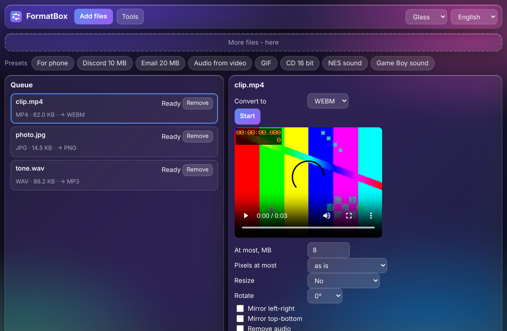
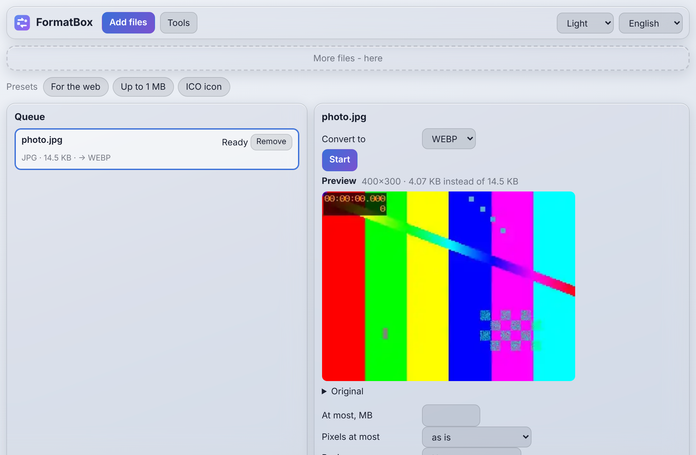

# FormatBox

One converter for everything: video, audio, images, documents, archives and 3D. Squeeze a file to a set size in MB
or to a set number of pixels, stretch, shrink or crop, pick the quality with a slider and see the result before
saving. Works offline. One code base: a web version (everything stays in the browser) and a desktop version
(Electron) with the real ffmpeg, LibreOffice and pandoc for big files and better documents.

[](CHANGELOG.md) [](https://github.com/ALEXalesha/FormatBox/actions/workflows/ci.yml) [](LICENSE) [](https://developer.mozilla.org/docs/Web/JavaScript) [](https://www.electronjs.org/) [](https://ffmpeg.org/) [](https://webassembly.org/) [](https://alexalesha.github.io/FormatBox/) [](https://claude.com/claude-code)

Code, tests and docs are written by Claude (Anthropic) in Claude Code; ideas, testing and decisions - Alexey.

[Русская версия](README.ru.md)

 

## What it does

| Group | What |
|---|---|
| Video | Any common format to any other (MP4, WebM, MKV, MOV, AVI, GIF); **size up to N MB** (two-pass bitrate, retried until it fits); **pixels up to N**; resize by percent or to width and height (fit, fill and crop, stretch); crop edges; cut a part; rotate, mirror; remove audio; speed 0.25-4×; frame rate; join several videos; audio from video |
| Audio | MP3, WAV, FLAC, OGG, Opus, M4A, AIFF; **bit depth 8/16/24/32 float, 8-96 kHz, mono or stereo, dither** (none, TPDF, noise shaped); **console sound**: NES, Game Boy and 16-bit presets (lower rate and depth, square waves); **replay on a console**: melody, bass and drums turned into notes and played back with NES pulse, triangle and noise channels, 10-second preview |
| Images | PNG, JPG, WebP, AVIF, BMP, ICO (several sizes), TIFF and HEIC on input; **size up to N KB/MB**; pixels up to N; resize, crop, rotate, mirror; quality slider with a live preview and the result size; remove the background; text watermark (corner or tiled); remove EXIF and GPS without recompressing |
| Documents | PDF, DOCX, ODT, Markdown, HTML, TXT between each other with the built-in module; the desktop version uses LibreOffice and pandoc when they are installed (one button opens the LibreOffice download page) |
| Archives | ZIP, 7z, TAR, TAR.GZ: look inside, extract, pack, repack; RAR, XZ and BZ2 extract only (licences in [web/core/archive/LICENSES.md](web/core/archive/LICENSES.md)) |
| 3D | STL, OBJ, 3MF, PLY, GLB between each other; mesh repair (holes, normals, duplicates, extra shells, self-intersections with manifold-3d, watertight check); fewer polygons; mm, cm or inches; volume, weight, filament length and cost; preview picture; **lithophane** (flat, curved, cylinder night light), relief from a height map, picture outline to a solid (keychain, sign, cookie cutter, stencil), color layers by height with M600 filament changes in G-code, text to 3D |
| Everywhere | Queue with cancel, presets ("For phone", "Discord 10 MB", "Audio from video", "NES sound", "For the web", "ICO icon" and more), five themes, Russian and English, narrow window |

Laws the code keeps: a result never overwrites an existing file and the source file is never changed; heavy work runs in
a Worker (web) or a separate process (desktop) and can be cancelled.

## How to run

Web version (needs Node.js 22+ only for the local server):

```bash
npm install
```

```bash
npm run serve
```

Then open http://127.0.0.1:8085/. The first video job loads ffmpeg.wasm (31 MB) once; after the first visit the page
works offline.

Desktop version:

```bash
npm start
```

It needs `ffmpeg` in PATH (or `FORMATBOX_FFMPEG`); LibreOffice and pandoc are optional.

Tests:

```bash
npm test
```

```bash
npm run cover && node tools/check-coverage.js
```

```bash
npm run test:web
```

```bash
xvfb-run -a npm run test:app
```

```bash
node tools/mutate.js
```

## Tests

- **Laws** on many random inputs with a fixed seed: the result is not larger than the set MB, has no more pixels than set,
  keeps the duration (±1 frame), never overwrites a name, never changes the source; a repaired mesh is watertight; an
  archive round trip is byte for byte; the WAV header has the chosen bit depth and rate, 8 bit has at most 256 levels;
  a replayed melody keeps the channel count, tempo and length within 2 % and the note pitches.
- **Branch coverage** (c8): core ≥ 90 %, all non-window code ≥ 80 %, checked in CI.
- **Mutants** (`tools/mutate.js`): every law catches its own deliberately broken copy of the code.
- **Window** (Playwright): the web version in headless Chromium and the desktop version in an invisible Electron window:
  real conversions, cancel, five themes with a contrast check, a 380 px window, 20 runs without memory growth.

## Planned

- Photo to 3D model with a neural network (TripoSR) - desktop only.
- Photogrammetry (COLMAP) - desktop only.
- "GPU acceleration" button for video (NVENC, QSV, VideoToolbox).
- A neural network that splits music into stems for "replay on a console" (the code already takes stems from any separator).

## Libraries

ffmpeg.wasm (MIT; the ffmpeg core is GPL-2.0-or-later), fflate (MIT), earcut (ISC), manifold-3d (Apache-2.0),
7z-wasm (LGPL-2.1 with the unRAR restriction), pdf.js (Apache-2.0), pdf-lib and fontkit (MIT), heic2any (MIT),
DejaVu Sans font (Bitstream Vera licence, [web/fonts/LICENSE-DejaVu.txt](web/fonts/LICENSE-DejaVu.txt)). The five
themes come from Paint Pro; `coi-sw.js` is the same file as in the Compiler project.

## License

MIT, see [LICENSE](LICENSE).
