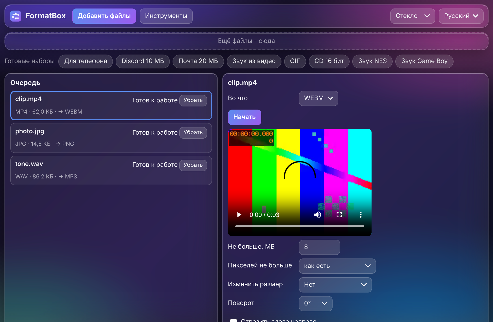
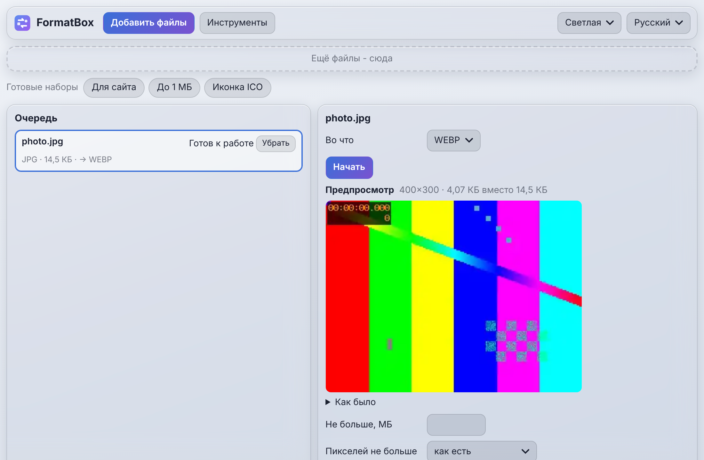

# FormatBox

Один конвертер для всего: видео, звук, картинки, документы, архивы и 3D. Сжать файл до заданного размера в МБ или до
заданного числа пикселей, растянуть, ужать или обрезать, выбрать качество ползунком и увидеть результат до сохранения.
Работает без интернета. Один код: веб-версия (всё остаётся в браузере) и версия для ПК (Electron) с настоящими ffmpeg,
LibreOffice и pandoc для больших файлов и лучших документов.

[](CHANGELOG.md) [](https://github.com/ALEXalesha/FormatBox/actions/workflows/ci.yml) [](LICENSE) [](https://developer.mozilla.org/docs/Web/JavaScript) [](https://www.electronjs.org/) [](https://ffmpeg.org/) [](https://webassembly.org/) [](https://alexalesha.github.io/FormatBox/) [](https://claude.com/claude-code)

Код, тесты и документацию написал Claude (Anthropic) в Claude Code; идеи, проверка и решения - Алексея.

[English version](README.md)

 

## Что умеет

| Группа | Что |
|---|---|
| Видео | Любой распространённый формат в любой (MP4, WebM, MKV, MOV, AVI, GIF); **размер до N МБ** (битрейт в два прохода, повтор, пока не влезет); **пикселей до N**; размер в процентах или по ширине и высоте (вписать, заполнить с обрезкой, растянуть); обрезка краёв; кусок по времени; поворот, отражение; убрать звук; скорость 0.25-4×; кадров в секунду; склейка нескольких видео; звук из видео |
| Звук | MP3, WAV, FLAC, OGG, Opus, M4A, AIFF; **разрядность 8/16/24/32 float, 8-96 кГц, моно или стерео, дизеринг** (нет, TPDF, с формой шума); **звук приставки**: наборы NES, Game Boy и 16 бит (ниже частота и разрядность, квадратные волны); **переиграть на приставке**: мелодия, бас и барабаны превращаются в ноты и звучат каналами NES - квадрат, треугольник и шум, предпросмотр 10 с |
| Картинки | PNG, JPG, WebP, AVIF, BMP, ICO (несколько размеров), на входе ещё TIFF и HEIC; **размер до N КБ/МБ**; пикселей до N; размер, обрезка, поворот, отражение; ползунок качества с живым предпросмотром и размером результата; убрать фон; водяной знак текстом (в углу или замостить); удалить EXIF и GPS без пережатия |
| Документы | PDF, DOCX, ODT, Markdown, HTML, TXT между собой встроенным модулем; версия для ПК берёт LibreOffice и pandoc, если они установлены (одна кнопка открывает страницу скачивания LibreOffice) |
| Архивы | ZIP, 7z, TAR, TAR.GZ: посмотреть, распаковать, упаковать, перепаковать; RAR, XZ и BZ2 - только распаковка (лицензии - в [web/core/archive/LICENSES.md](web/core/archive/LICENSES.md)) |
| 3D | STL, OBJ, 3MF, PLY, GLB между собой; починка сетки (дыры, нормали, дубли, лишние оболочки, самопересечения через manifold-3d, проверка водонепроницаемости); меньше полигонов; мм, см или дюймы; объём, вес, длина нити и цена; картинка-превью; **литофания** (плоская, изогнутая, цилиндр-ночник), рельеф по карте высот, силуэт картинки в объём (брелок, табличка, формочка для печенья, трафарет), цветные слои по высоте со сменой пластика M600 в G-code, текст в 3D |
| Везде | Очередь с отменой, готовые наборы («Для телефона», «Discord 10 МБ», «Звук из видео», «Звук NES», «Для сайта», «Иконка ICO» и другие), пять тем, русский и английский, узкое окно |

Законы, которые код соблюдает: результат никогда не перетирает существующий файл, исходный файл не меняется; тяжёлая
работа идёт в Worker (веб) или в отдельном процессе (ПК) и отменяется.

## Как запустить

Веб-версия (Node.js 22+ нужен только для местного сервера):

```bash
npm install
```

```bash
npm run serve
```

Потом открыть http://127.0.0.1:8085/. Первое видео загружает ffmpeg.wasm (31 МБ) один раз; после первого открытия
страница работает без интернета.

Версия для ПК:

```bash
npm start
```

Нужен `ffmpeg` в PATH (или `FORMATBOX_FFMPEG`); LibreOffice и pandoc - по желанию.

Тесты:

```bash
npm test
```

```bash
npm run cover && node tools/check-coverage.js
```

```bash
npm run test:web
```

```bash
xvfb-run -a npm run test:app
```

```bash
node tools/mutate.js
```

## Тесты

- **Законы** на многих случайных входах с зерном: результат не больше заданных МБ, пикселей не больше заданного,
  длительность сохраняется (±1 кадр), имя не перетирает чужой файл, источник не меняется; починенная сетка
  водонепроницаема; архив туда-обратно байт в байт; в заголовке WAV выбранные разрядность и частота, в 8 битах не
  больше 256 уровней; переигранная мелодия сохраняет число каналов, темп и длительность в пределах 2 % и высоту нот.
- **Покрытие по ветвям** (c8): ядро ≥ 90 %, весь код без окон ≥ 80 %, порог проверяется в CI.
- **Мутанты** (`tools/mutate.js`): каждый закон ловит свою нарочно сломанную копию кода.
- **Окно** (Playwright): веб-версия в невидимом Chromium и версия для ПК в невидимом окне Electron: настоящие
  преобразования, отмена, пять тем с проверкой контраста, окно 380 px, 20 прогонов без роста памяти.

## В планах

- Фото в 3D-модель нейросетью (TripoSR) - только на ПК.
- Фотограмметрия (COLMAP) - только на ПК.
- Кнопка «Ускорение видеокартой» для видео (NVENC, QSV, VideoToolbox).
- Нейросеть, которая делит музыку на дорожки для «переиграть на приставке» (код уже принимает дорожки от любого разделителя).

## Библиотеки

ffmpeg.wasm (MIT; ядро ffmpeg - GPL-2.0-or-later), fflate (MIT), earcut (ISC), manifold-3d (Apache-2.0),
7z-wasm (LGPL-2.1 с ограничением unRAR), pdf.js (Apache-2.0), pdf-lib и fontkit (MIT), heic2any (MIT), шрифт DejaVu Sans
(лицензия Bitstream Vera, [web/fonts/LICENSE-DejaVu.txt](web/fonts/LICENSE-DejaVu.txt)). Пять тем взяты из Paint Pro;
`coi-sw.js` - тот же файл, что в проекте Compiler.

## Лицензия

MIT, см. [LICENSE](LICENSE).
